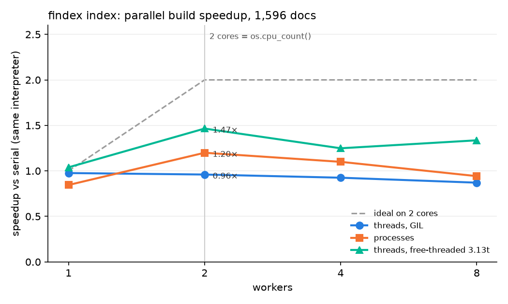

# findex — a search engine built from scratch in Python

> **Live demo:** `https://findex-<user>.onrender.com` — *to be filled in after deployment (see Lab 7, "Deployment")* · API docs at `/docs`

[](https://github.com/<user>/findex/actions/workflows/ci.yml)

Semester project for the course *Python — Build a Search Engine*. One lab = one language feature + one project step.

## Corpus

Documentation of the Python ecosystem: **CPython `Doc/`, Django `docs/`, NumPy `doc/source/`** — 1,596 plain-text documents, ~26 MB, ~3.1 M tokens, 63.6 K distinct terms. English prose with a lot of code identifiers (`__init__`, `read_csv`), which shaped the tokenizer policy.

The corpus is **not** in git (`data/` is in `.gitignore`). To get it:

```bash
./scripts/get_corpus.sh        # sparse-clones the three repos, copies sources to data/<project>/...txt
```

## Lab 1 — Streams, not lists

```bash
uv sync
uv run python -m findex.stats data/ [--limit N] [--eager]
uv run pytest
```

* `findex.corpus.iter_documents(root)` — generator; opens one file at a time; supports a directory of `.txt` files and a `.jsonl` file (one document per line). Undecodable bytes are logged and replaced, the build does not crash.
* `findex.tokenize.tokenize(text)` — generator over `re.finditer`: NFC → `casefold()` → regex `\w+(?:'\w+)*`.
* `findex.stats` — one pass, a `Counter` is the only thing that grows; `--limit` uses `itertools.islice`.

**Tokenizer policy.** Letters of any script, digits and `_` form a token (`__init__`, `read_csv`, `utf8` stay whole — this is code documentation). Apostrophes inside a word are kept (`don't`, `п'ять`; `’` and `ʼ` are mapped to `'` first), leading/trailing ones are dropped. Hyphens split (`built-in` → `built`, `in`). Numbers split on the dot (`3.13` → `3`, `13`).

### Eager vs lazy (full corpus, median of 3 runs, `tracemalloc` peak)

| Version | Documents | Tokens | Peak memory (MiB) | Elapsed (s) |
|---|---|---|---|---|
| eager (lists) | 1,596 | 3,075,752 | 212.0 | 11.01 (±0.19) |
| lazy (generators) | 1,596 | 3,075,752 | 8.1 | 10.27 (±0.38) |

**Where the memory went.** The eager version keeps three things alive at the same time: the full text of all 1,596 documents (~26 MB of `str`), a list of lists with a reference to every one of the 3.1 M tokens (8 bytes per pointer plus a new `str` object for most tokens, ~50 bytes each), and the flattened copy of that list (another 3.1 M pointers, ~25 MB). The lazy version holds at most one document's text and the current match; what remains in its 8 MiB peak is the `Counter` itself — 63.6 K keys and int values in a hash table — plus the list of file *paths*. That is the answer, so it has to be in memory; everything upstream is a stream. Time is roughly the same: the work (regex + hashing) is identical, the eager version just additionally allocates and frees the lists.

## Lab 2 — The inverted index

```bash
uv run python -m findex.index data/ --out index.bin [--positions] [--format pickle|binary]
uv run python -m findex.search index.bin "dict OR set NOT django" [--engine merge|set]
uv run python scripts/bench_lab02.py data        # every table below
```

* `findex.models` — `Posting(doc_id, tf, positions=())` and `DocMeta(path, title)`, both `@dataclass(frozen=True, slots=True)`: hashable, no per-instance `__dict__`.
* `findex.index.build_index` — one pass over the lazy Lab 1 pipeline; per document a `Counter` is flushed into a `defaultdict(list)`. Documents come in `doc_id` order, so the postings are sorted by construction. Output: `postings`, `doc_lengths`, `doc_meta`. `--positions` stores token offsets.
* `findex.search` — two-pointer `merge_and/or/not` and `set_*` alternatives; left-to-right query `a b`, `a OR b`, `a NOT b`.
* `findex.store` — `pickle` (with the RCE warning as a comment in `load_pickle`) and a binary format: magic + JSON header (term → offset, count) + contiguous `array('I')` buffers.

Index: 1,596 documents, 63,582 terms, 650,769 postings.

### Save / load (median of 3, without tracemalloc)

| Format | Positions | File size (MiB) | Save (s) | Load (s) |
|---|---|---|---|---|
| pickle | no | 10.9 | 2.71 | 3.62 |
| binary | no | 6.7 | 0.17 | 1.69 |
| pickle | yes | 20.2 | 3.51 | 4.01 |
| binary | yes | 18.5 | 0.74 | 2.12 |

Positions cost ×2.8 in the binary file (6.7 → 18.5 MiB): one 4-byte number per *token* (3.1 M) instead of two per *posting* (0.65 M). Loading is dominated by re-creating 650 K `Posting` objects, not by I/O; the binary format saves fast because `array.tobytes()` is one memcpy per term.

> **pickle is a security hole.** `pickle.load` runs the opcodes in the file, and a `__reduce__` can call any function (`os.system`). It is fine only for an index this program wrote itself — never for a file from the network.

### Merge vs set (µs per operation, `timeit`)

| Terms (df) | Op | merge (µs) | set (µs) | result |
|---|---|---|---|---|
| `the` (1474) & `in` (1480) | AND | 153.9 | 62.6 | 1429 docs |
| `the` (1474) & `in` (1480) | OR | 170.1 | 71.0 | 1525 docs |
| `prebuilt` (2) & `sphinxbuild` (2) | AND | 0.2 | 0.3 | 1 docs |
| `prebuilt` (2) & `sphinxbuild` (2) | OR | 0.3 | 0.4 | 3 docs |
| `in` (1480) & `author` (100) | AND | 138.2 | 22.6 | 100 docs |
| `in` (1480) & `author` (100) | OR | 146.9 | 41.2 | 1480 docs |

Both are O(len(a) + len(b)), but the set version does its loop in C (building the hash tables, intersecting, sorting), while the merge does every comparison and index increment as Python bytecode — 2.5–6× slower on the frequent terms. On the rare terms (two elements) the merge wins slightly: no set objects to allocate. The merge is still the right *algorithm* for an engine: it streams, needs no extra memory and works on compressed or memory-mapped postings (Lab 8 moves it into NumPy).

### Memory study (postings only, same corpus, `tracemalloc`)

| Postings representation | Peak memory, build (MiB) | Retained (MiB) | Pickle file (MiB) | Load (s) |
|---|---|---|---|---|
| `list[Posting]`, plain `@dataclass` | 71.3 | 69.5 | 12.7 | 0.41 |
| `list[Posting]`, `slots=True` | 46.5 | 44.6 | 10.2 | 1.49 |
| `array('I')` pairs, no objects | 26.3 | 24.4 | 7.8 | 0.09 |

**Where the bytes went.** 650,769 postings. *Plain dataclass*: ~110 bytes per posting — the object header and its attribute storage (on 3.13 the values live inline, so the per-instance dict is smaller than the "100+ bytes" of older Pythons, but each object still carries the inline-values block and a dict pointer), plus an 8-byte pointer from the list. *Slots*: the object is a fixed 2-slot C struct (`getsizeof` 48 → no hidden dict), ~72 bytes per posting with the list pointer; ×1.5 smaller. Small `int`s (< 257) are cached singletons, and larger doc_ids are separate 28-byte `int` objects in both object rows. *Arrays*: 8 bytes per posting (two raw `uint32`), i.e. ~5 MiB for all postings; the remaining ~20 MiB is per-*term* overhead — 63.6 K keys (`str` objects ~55 B), dict entries and two `array` headers per term — and most terms have df = 1, so for this corpus term overhead dominates. Pickle load of the slotted class is *slower* (1.49 s vs 0.41 s) because `slots=True` dataclasses pickle through a Python-level `__getstate__/__setstate__`, while plain instances use the C fast path for `__dict__`.

REPL experiments (`scripts/experiments/lab02_repl.py`): `dict` grows at 6 → 11 → 22 entries (2/3 load factor); a `__hash__` returning 42 makes 10,000 lookups in a 2,000-element set take 1,202 ms instead of 0.9 ms; `hash('hello')` differs between processes unless `PYTHONHASHSEED=0`; 1 M three-field objects take 130 MiB plain vs 92 MiB slotted; `array('I', range(10**6))` is 3.9 MiB vs 7.6 MiB for the list *plus* 26.7 MiB of `int` objects it points to.

## Lab 3 — Ranking and the object model

```bash
uv run python -m findex.index data/ --out index.bin --positions
uv run python -m findex.search index.bin 'python AND (async OR await) NOT java "event loop"' --rank bm25 --k 5 -v
uv run python scripts/sanity_lab03.py index.bin   # the three ranking sanity checks
uv run python scripts/eval_lab03.py index.bin     # precision@5
```

* `findex.index.Index(Mapping[str, list[Posting]])` — `len`, `in`, `ix[term]` (`KeyError` if absent), iteration, `repr` → `Index(terms=63_582, docs=1_596, positions=True)`; `num_docs` (`property`), `avg_doc_length` (`cached_property` — computed once, BM25 reads it for every posting), `df()`, `doc_length()`, `doc_text()`.
* `findex.store.open_index(path)` — `@contextmanager`; `close()` runs in `finally`, also when the body raises (tested).
* `findex.scoring` — `Scorer` protocol (`score(term, posting, index) -> float`); `TfIdf` and `BM25(k1=1.5, b=0.75)` are frozen dataclasses (hashable → usable as `lru_cache` keys) with `__call__`, no common base class.
* `findex.query` — recursive-descent parser → `Term`/`Phrase`/`And`/`Or`/`Not` nodes; nodes overload `&`, `|`, `~`; `evaluate(index)` uses the Lab 2 merges; phrases check positions (`p`, `p+1`, …). Parser tests compare trees: `parse("a OR b c") == Or(Term("a"), And(Term("b"), Term("c")))`.
* `findex.ranking` — scores accumulate in a dict over the matched set, top-k by `heapq.nlargest` (O(n log k)); `SearchResult(score, doc_id, title, path, snippet)` is `order=True` — score is the *first* field so that ordering means relevance.
* `@timed` (`findex.timing`, with `functools.wraps`) on `build_index`, `load`, `rank`, `search_page` → DEBUG log. A per-index `functools.lru_cache(maxsize=256)` caches query → ranked ids.
* Snippets: ±80 characters around the match whose window contains the most distinct query terms, matches wrapped in `**…**`.

### Cache hit in the log (`-v`)

```text
findex.timing: rank took 3.7 ms
findex.timing: search_page took 18.5 ms
 1.  24.951  A conceptual overview of asyncio  (cpython/howto/a-conceptual-overview-of-asyncio.txt)
findex.ranking: cache hit for 'python AND (async OR await) NOT java "event loop"' (bm25, k=3)
findex.timing: search_page took 14.0 ms
```

On the second run `rank` is not called at all (no `rank took` line). What remains (~14 ms) is building snippets — decompressing three documents and running the highlight regex — which is deliberately not cached.

### Ranking sanity checks (real corpus, `scripts/sanity_lab03.py`)

1. **Rare beats common.** Query `the OR pickletools` (df 1474 vs 8): the best document containing `pickletools` is rank 1 with BM25 12.22; the best document with only `the` is rank 9 with 0.20.
2. **Saturation.** BM25 contribution of `generator` (df 132) in a document of average length (1,930 tokens): tf 1 → 2.49, 2 → 3.55, 5 → 4.79, 10 → 5.41, 19 → 5.77, 20 → 5.79. The 20th occurrence adds 0.021 (0.37 % of the score); the ceiling is idf·(k1+1) = 6.22. TF-IDF with `1+log tf` keeps growing: 2.49 → 9.96.
3. **Length normalisation.** `sentinel` occurs once in a 291-token document (`c-api/concrete`) and once in a 28,485-token one (`numpy c-api/array`): BM25 6.12 vs 0.53 (rank 7 vs 36 of 36); TF-IDF gives both exactly 3.79.

### precision@5, TF-IDF vs BM25 (10 hand-labelled queries in `eval/queries.json`, query = OR of its words)

| # | Query | relevant | P@5 TF-IDF | P@5 BM25 |
|---|---|---|---|---|
| 1 | asyncio task cancellation timeout | 3 | 0.2 | 0.2 |
| 2 | pickle security untrusted data | 1 | 0.2 | 0.2 |
| 3 | numpy broadcasting rules | 2 | 0.2 | 0.2 |
| 4 | django database migrations | 3 | 0.2 | 0.6 |
| 5 | logging handler formatter | 5 | 0.6 | 0.6 |
| 6 | regular expression groups | 2 | 0.4 | 0.4 |
| 7 | dataclass frozen slots | 1 | 0.2 | 0.2 |
| 8 | django cache backend | 1 | 0.2 | 0.2 |
| 9 | random number generator seed | 5 | 0.6 | 0.6 |
| 10 | free threading GIL | 4 | 0.8 | 0.4 |
| | **mean** | | **0.36** | **0.36** |

With only 1–5 relevant documents per query the maximum P@5 is often 0.2–0.6, so the means are small by construction (the ceiling for this set is 0.54). The two scorers tie on average: BM25 wins on *django database migrations* (TF-IDF pulls in the very long release notes that mention "database" hundreds of times; length normalisation pushes them down), TF-IDF wins on *free threading GIL*, where the relevant documents are the long *What's New in 3.13/3.14* pages that BM25 penalises for length. Ten queries is noise-level evidence; the habit of measuring is the point.

## Lab 4 — A real tool: typing, tests, packaging, CLI

```bash
uv tool install .                     # or: uv tool install dist/findex-0.4.0-py3-none-any.whl
findex index data/ --out index.bin    # rich progress bar on stderr
findex search index.bin 'asyncio (TaskGroup OR gather) "structured concurrency"' -k 3
findex search index.bin 'dataclass frozen' --json | jq .path
findex stats index.bin --top 20
findex -vv search ...                 # DEBUG log (@timed, cache hits) on stderr
```

* **Typing.** `[tool.pyright] typeCheckingMode = "strict"` over `src/` and `tests/`: **0 errors**. Generators return `Iterator[...]`, functions accept `Iterable[...]`; `Scorer` is a `typing.Protocol`; `@timed` is generic with PEP 695 `[**P, R]`; `type Ranked = ...` alias; `Literal["pickle", "binary"]` for formats; the binary header is a `TypedDict`. Strict mode found a real bug: `Scorer.name` was declared as a writable attribute, but the frozen dataclasses only provide a read-only one — the protocol now declares it as a `@property`. One `# type: ignore` remains (`__hash__ = None` on `Index`, with the reason in the comment); `json.loads` output goes through one documented `cast`.
* **Tests.** 47 pytest tests (`uv run pytest`): parametrized tokenizer table (Cyrillic, combining marks, `ß`), a session-scoped corpus fixture in `conftest.py`, merges, parser trees, both scorers with the three Lab 3 sanity checks, store round trip, `open_index` cleanup on exception, CLI through `typer.testing.CliRunner` (table, `--json`, exit codes 1/2, no traceback). **Hypothesis properties** (`tests/test_properties.py`): merges equal set operations for any sorted lists; `tokenize` is idempotent and never yields empty tokens; `load(save(index)) == index` for generated corpora in both formats, with sorted postings; `parse(str(tree)) == tree` for generated query trees. One test is marked `slow` (indexes 200 real documents).
* **Coverage: 83 %** (branch coverage). Not covered on purpose: the old `python -m findex.index/search/stats` argparse entry points from Labs 1–3 (kept for the earlier labs' instructions; the `findex` CLI replaces them) and `Index.close()` paths only reached through the CLI.
* **Packaging.** PEP 621 `pyproject.toml`, `uv.lock` committed, `src/` layout, `[project.scripts] findex = "findex.cli:app"`, version 0.4.0. `uv build` → `dist/findex-0.4.0-py3-none-any.whl`; installed into a clean tool environment with `uv tool install <wheel>` → `findex --help` and `findex --version` work (the installer writes a `bin/findex` script that imports `findex.cli:app`).
* **Logging.** `log = logging.getLogger(__name__)` in modules; configured once in the CLI callback (`-v` INFO, `-vv` DEBUG) with a `RichHandler` on **stderr**; data (tables, JSON lines) on stdout. Expected errors print one line and exit non-zero: missing index → 1, bad query syntax → 2.
* **CI.** `.github/workflows/ci.yml`: `uv sync --locked`, `ruff check`, `ruff format --check`, `pyright`, `pytest` on every push/PR, on 3.13 and free-threaded 3.13t.
* **Release.** `git tag v0.4.0 && gh release create v0.4.0 dist/findex-0.4.0-py3-none-any.whl` — then anyone can `uv tool install https://github.com/<user>/findex/releases/download/v0.4.0/findex-0.4.0-py3-none-any.whl`.

```text
         'asyncio (TaskGroup OR gather) "structured concurrency"': 1 matches, top 1 by bm25 (2.6 ms)
┏━━━┳━━━━━━━┳━━━━━━━━━━━━━━━━━━━━━━━━━━━━━━━━━━┳━━━━━━━━━━━━━━━━━━━━━━━━━━━━━━━━━━━━━━━━━━━━━━━━━━━━━━━━━━━━━┓
┃ # ┃ score ┃ document                         ┃ snippet                                                     ┃
┡━━━╇━━━━━━━╇━━━━━━━━━━━━━━━━━━━━━━━━━━━━━━━━━━╇━━━━━━━━━━━━━━━━━━━━━━━━━━━━━━━━━━━━━━━━━━━━━━━━━━━━━━━━━━━━━┩
│ 1 │ 33.88 │ Coroutines and tasks             │ …classes :exc:`BaseException` so most code will not need to │
│   │       │ cpython/library/asyncio-task.txt │ be aware of it. The asyncio components that enable          │
│   │       │                                  │ structured concurrency, like :class:`asyncio.TaskGroup`…    │
└───┴───────┴──────────────────────────────────┴─────────────────────────────────────────────────────────────┘
```

## Lab 5 — Concurrency and the GIL: parallel indexing

```bash
findex index data/ --out index.bin --executor processes --workers 2   # serial | threads | processes
uv run python scripts/bench_lab05.py .venv/bin/python bench/lab05.jsonl          # GIL build
uv run python scripts/bench_lab05.py .venv-ft/bin/python bench/lab05_ft.jsonl    # free-threaded 3.13t
uv run python scripts/report_lab05.py                                            # table + docs/lab05_speedup.png
```

* `findex.parallel.build_partial(root, paths, start_id, positions)` — module-level (picklable), receives **paths and a doc_id range**, reads its own files, returns a `PartialIndex` of compact `array('I')` buffers (doc_ids, tfs, flattened positions) — arrays pickle as raw bytes, unlike 0.65 M `Posting` objects.
* `merge(partials)` — sorts partials by `start_id` and concatenates per term: ranges are disjoint and increasing, so concatenation *is* the sorted merge; then materialises `Posting` objects.
* Serial = `merge([build_partial(root, all_paths, 0)])`. **Tested** to be equal to the Lab 4 builder, and the threads/processes indexes equal it too (`tests/test_parallel.py`); on the full corpus the three `index.bin` files are **byte-identical** (`cmp`).
* `--executor {serial,threads,processes} --workers N`; the pool is `ProcessPoolExecutor(mp_context=get_context("spawn"))`; benchmark scripts launch under `if __name__ == "__main__"`. A worker exception is re-raised by `fut.result()` in the parent with the worker's traceback attached, remaining futures are cancelled (tested with a monkeypatched `read_text` that raises).
* Default: `--executor processes --workers os.cpu_count()` — it wins on this machine.

**Machine:** Intel Xeon @ 2.10 GHz, **2 vCPUs** (`os.cpu_count() == 2`), 7.8 GB RAM, Linux; CPython 3.13.18 and 3.13.14t (free-threaded, `uv python install 3.13t`, `sys._is_gil_enabled() == False`). Full corpus with positions, 4 chunks per worker, each configuration: 1 warm-up + 3 measured runs in fresh processes; wall = `perf_counter`, CPU = user+sys of the process **and its children** (`getrusage`), RSS = parent's `ru_maxrss`.

| Python | Executor | Workers | Wall (s, median) | spread | CPU (s) | Peak RSS (MiB) | Merge (s) | Speedup vs 3.13 serial |
|---|---|---|---|---|---|---|---|---|
| 3.13 | serial | 1 | 4.50 | ±0.11 | 4.50 | 278 | 1.06 | 1.00× |
| 3.13 | threads | 1 | 4.61 | ±0.22 | 4.61 | 292 | 1.16 | 0.98× |
| 3.13 | threads | 2 | 4.68 | ±0.06 | 5.02 | 302 | 1.19 | 0.96× |
| 3.13 | threads | 4 | 4.86 | ±0.07 | 5.24 | 319 | 1.17 | 0.93× |
| 3.13 | threads | 8 | 5.17 | ±0.08 | 5.52 | 344 | 1.26 | 0.87× |
| 3.13 | processes | 1 | 5.32 | ±0.20 | 5.50 | 312 | 1.30 | 0.85× |
| 3.13 | processes | 2 | 3.75 | ±0.14 | 5.82 | 314 | 1.26 | 1.20× |
| 3.13 | processes | 4 | 4.09 | ±0.18 | 6.24 | 322 | 1.51 | 1.10× |
| 3.13 | processes | 8 | 4.77 | ±0.11 | 7.44 | 340 | 1.64 | 0.94× |
| 3.13t (GIL off) | serial | 1 | 5.88 | ±0.22 | 5.86 | 339 | 1.46 | 0.76× |
| 3.13t (GIL off) | threads | 1 | 5.66 | ±0.49 | 5.67 | 355 | 1.47 | 0.79× |
| 3.13t (GIL off) | threads | 2 | 4.01 | ±0.19 | 6.14 | 369 | 1.39 | 1.12× |
| 3.13t (GIL off) | threads | 4 | 4.71 | ±0.20 | 7.20 | 389 | 1.56 | 0.95× |
| 3.13t (GIL off) | threads | 8 | 4.40 | ±0.30 | 6.84 | 415 | 1.43 | 1.02× |
| 3.13t (GIL off) | processes | 1 | 6.95 | ±0.37 | 7.11 | 369 | 1.59 | 0.65× |
| 3.13t (GIL off) | processes | 2 | 4.54 | ±0.18 | 6.94 | 375 | 1.55 | 0.99× |
| 3.13t (GIL off) | processes | 4 | 5.32 | ±0.19 | 8.44 | 387 | 1.59 | 0.85× |
| 3.13t (GIL off) | processes | 8 | 5.63 | ±0.34 | 9.18 | 403 | 1.60 | 0.80× |



### Why the numbers look like this

**Threads under the GIL did not speed anything up (0.96× at 2, 0.87× at 8).** Tokenising (regex), counting (dict updates) and building arrays are Python bytecode, and a thread must hold the GIL to execute bytecode. With 2 threads, one runs while the other waits for the lock; every 5 ms (`sys.getswitchinterval()`) the holder is asked to drop it and the threads trade places. Total work is unchanged, but switching, contention and cache misses are added — so CPU time grows (4.50 → 5.52 s) and wall time grows with more threads. Only file reads release the GIL, and the corpus is in the page cache, so there is almost nothing to overlap.

**Processes did speed up (1.20× at 2 workers), and here is what it cost.** Each process has its own interpreter and its own GIL, so two chunks really are tokenised at the same time on the two cores. The price: (1) *startup* — `spawn` starts a new interpreter and re-imports `findex` in each worker; one worker in a pool is 0.8 s slower than serial (5.32 vs 4.50 s); (2) *the pickling tax* — every partial index is pickled in the worker, sent over a pipe and unpickled in the parent; (3) *coordination* — at 2 workers CPU is 5.82 s for 3.75 s wall: ~1.3 s of extra CPU is spent on startup, pickling and merging partial results that the serial build never does. More workers than cores (4, 8) only add these costs: 8 processes are slower than serial. RSS of the parent grows modestly (278 → 314 MiB) because it holds the unpickled partials and the merged index at the same time.

**Amdahl's law.** The merge is sequential and takes ~1.1–1.3 s of the 4.5 s serial build (≈ 24 %; it materialises 650 K `Posting` objects in the parent). With p = 0.76 parallelisable, the ceiling is 1/(0.24 + 0.76/2) = **1.6× on 2 cores** and 1/0.24 ≈ **4.2× on infinite cores**. We got 1.20× on 2 cores — the gap to 1.6× is the process tax above. To raise the ceiling, the merge itself must get cheaper (keep arrays instead of `Posting` objects — that is what Lab 8 does with NumPy).

**Free-threaded 3.13t.** The same `ThreadPoolExecutor` code now scales: threads ×2 = **1.47×** over the 3.13t serial run, because both threads execute bytecode in parallel. Two caveats are visible in the table: the single-thread overhead of the free-threaded build is large on this workload (serial 5.88 s vs 4.50 s — ~30 %, more than the 5–10 % usually quoted; dict-heavy code pays for per-object locking and the disabled specialisations of 3.13t), so in absolute terms 3.13t threads (4.01 s) are only slightly faster than 3.13 processes (3.75 s); and processes are the slowest option on 3.13t.

**The bug the GIL was hiding.** `build_partial` shares nothing, so the indexer had no race. To check the claim, `scripts/experiments/lab05_race.py` has 4 threads do `shared[key] += 1` on one `Counter` 200 000 times each:

```text
python 3.13.18 GIL=True:  unsafe total=800,000 expected=800,000 lost=0
python 3.13.14 GIL=False: unsafe total=791,325 expected=800,000 lost=8,675
python 3.13.14 GIL=False: safe   total=800,000 expected=800,000 lost=0
```

`+=` is three steps (`BINARY_SUBSCR`/load, `BINARY_OP +=`, `STORE_SUBSCR`). With the GIL, a switch between them is rare enough that this run lost nothing — the code is still *incorrect*, just lucky. Without the GIL two threads read the same old value at the same time and one increment is overwritten: 8,675 updates lost. Fix: a `threading.Lock` around the update (`safe`), or — what `findex` does — no shared mutable state at all: each worker returns its own partial result and only the parent merges.

### Counter-benchmark: where threads *do* scale (I/O-bound)

50 HTTP GETs to a local server that answers after 100 ms (`scripts/experiments/lab05_io.py`), `ThreadPoolExecutor`, GIL build:

| Threads | 50 requests, wall (s) | Speedup |
|---|---|---|
| 1 | 5.11 | 1.0× |
| 5 | 1.03 | 5.0× |
| 10 | 0.54 | 9.5× |
| 25 | 0.23 | 22.3× |
| 50 | 0.14 | 35.8× |

Waiting on a socket releases the GIL, so the waits overlap: 50 threads are 36× faster on 2 cores. (First attempt showed 25 threads *slower* than 10: `http.server`'s default listen backlog is 5, extra connections were dropped and retried after 1 s — fixed with `request_queue_size = 128`.) Same API, opposite result: threads for waiting, processes (or no-GIL) for computing.

## Lab 6 — The async crawler

```bash
uv run python scripts/mirror_server.py --port 8765          # the local mirror (see "Ethics")
findex -v crawl http://127.0.0.1:8765/ --max-pages 300 --concurrency 20 --per-host 2 --delay 0.1 \
    --allow-domain 127.0.0.1 --allow-domain 127.0.0.2 --allow-domain 127.0.0.3 --out data/crawl.jsonl --debug
findex index data/crawl.jsonl --out crawl.bin && findex search crawl.bin '"event loop"'
uv run python scripts/bench_lab06.py                        # the table below
```

**Ethics / permission.** The crawler was run **only against a local mirror** that I generated from my own corpus (`scripts/mirror_server.py`): 1,668 pages on three loopback "hosts" (127.0.0.1 = Python docs, 127.0.0.2 = Django, 127.0.0.3 = NumPy), with 50–200 ms random latency per response and deliberate misbehaviour (every 50th request → 429 with `Retry-After: 1`, every 70th → 503, a `/loop/a ↔ /loop/b` redirect loop, a 404, `/private/` disallowed in `robots.txt`, links to an external site and URL variants that differ only by fragment, slash or query order). No third-party site was crawled. The crawler sends `User-Agent: findex-crawler/0.7 (+https://github.com/<user>/findex; student project)`, obeys `robots.txt`, limits requests per host and stays inside the domain allowlist.

* `crawler/fetch.py` — `fetch(client, url)`: `asyncio.timeout` per attempt; retries **only** 429, 5xx, timeouts and transport errors, at most 3 times, with exponential backoff + jitter (`min(cap, 0.5·2^n) + U(0, 0.5)`); a 429's `Retry-After` (seconds or HTTP date) replaces the backoff; other 4xx are never retried; redirect loops (`TooManyRedirects`) are recorded, not retried. Returns `FetchResult(url, status, final_url, content_type, text, nbytes, elapsed, attempts, error)`.
* `crawler/robots.py` — `RobotsCache`: one `robots.txt` request per host (an `asyncio.Lock` per origin, so 20 workers do not fetch it 20 times — tested); 4xx → allow all, 5xx/unreachable → disallow all.
* `crawler/urls.py` — canonicalisation: absolute URL, lowercase scheme and host, default port dropped, `//` collapsed, fragment removed, trailing slash removed (except `/`), query parameters sorted.
* `crawler/crawl.py` — `crawl(seeds, ...) -> AsyncIterator[Page]`: an `asyncio.Queue` frontier; `concurrency` workers in an `asyncio.TaskGroup`; a global `Semaphore(concurrency)`, a `Semaphore(per_host)` per host and a per-host minimum delay (`asyncio.sleep`, the slot is reserved before sleeping); a `seen` set of canonical URLs (redirect targets included); HTML parsed with selectolax (lexbor): title, text without `<script>/<style>`, links. When `max_pages` is reached, a `stop` event wakes the supervisor, which cancels the workers (they get `CancelledError` at their current `await`), the `async with` closes the `httpx.AsyncClient` (one client and connection pool for the whole crawl). Pages are handed to the consumer through a bounded queue (backpressure).
* `findex crawl` writes **one JSON line per page as it arrives** (`url, title, text, fetched_at`), so `iter_documents` (Lab 1) reads it and `findex index data/crawl.jsonl` indexes it — outside the event loop. A `rich.Live` panel on stderr shows pages, pages/s, in-flight, queue depth, errors/retries, robots blocks. `crawl.log` has one TSV line per URL (`time, status, bytes, elapsed, attempts, url, error`); a sample is in `docs/crawl.sample.log`.
* Tests (`tests/test_crawler.py`, 17 tests): `httpx.MockTransport` only — retries and backoff (with an injected fake `sleep`), `Retry-After`, 404 not retried, give-up after 3, timeouts, connection errors, robots cache fetched once, a whole mini-site crawl: no URL fetched twice, allowlist respected, robots honoured, 404 logged, `max_pages` respected, no script text. They run with `asyncio.run(..., debug=True)`.
* `--debug` runs the loop with `asyncio.run(debug=True)`: on the 300-page crawl below **no "Executing … took" warning** appeared, i.e. no callback blocked the loop for > 100 ms.

### Benchmark (local mirror, same seed, 300 pages, fresh process per run)

| Concurrency | Per-host limit | Per-host delay (s) | Pages | Wall (s) | Pages/s | Errors | Retries | Peak RSS (MiB) |
|---|---|---|---|---|---|---|---|---|
| 1 | 2 | 0.1 | 300 | 50.4 | 6.0 | 2 | 8 | 48 |
| 5 | 2 | 0.1 | 300 | 34.0 | 8.8 | 2 | 11 | 49 |
| 20 | 2 | 0.1 | 300 | 25.6 | 11.7 | 6 | 10 | 50 |
| 20 | 20 | 0.0 | 300 | 2.7 | 110.1 | 2 | 5 | 49 |

### Explanation

**Why 20 concurrent requests in one thread beat the Lab 5 approach here.** A fetch is ~125 ms of *waiting* for a response and well under 1 ms of CPU (parse + link extraction with a C parser). While one coroutine waits on its socket it is suspended at `await`, and the event loop runs the others; with no politeness limits, 20 in-flight requests give **110 pages/s vs 6 pages/s** sequentially (18×) on one thread — and peak RSS stays ~49 MiB at any concurrency, because a waiting coroutine costs a few KB, not a thread stack. Lab 5's indexer was the opposite workload: all CPU and no waiting, so there was nothing to overlap and only extra cores could help.

**What the per-host limits cost, and why I kept them.** With `--per-host 2 --delay 0.1` the same 20 workers make only 11.7 pages/s: each host gets at most 2 requests in flight and one new request per 100 ms, i.e. ≤ 10 pages/s per host, ≤ 30 for all three — and the frontier is filled breadth-first, mostly with pages of the first host, so workers queue up at that host's gate while other hosts are idle (head-of-line blocking; per-host frontier queues would fix it). That is a 9× slowdown, and it is the point: unbounded concurrency would be a denial-of-service attack on a real site. The real crawler keeps the limits; the 20/20/0 row exists only because the server is mine.

**Where the loop would have blocked.** If each page were tokenised and indexed inside the worker coroutine (Lab 4's `build_index` is ~3 ms of pure Python per average document, much more for large ones), every other coroutine would be frozen during that time — 20 workers would effectively run one after another and `debug=True` would print "Executing … took 0.2 seconds" for the big documents. So the crawler only writes JSON lines; `findex index` runs afterwards, separately (or, if indexing during the crawl were required, in a `ProcessPoolExecutor` via `loop.run_in_executor`).

**A handled failure (from `crawl.log` and the `-v` log).** The 429 from the mirror, honoured via `Retry-After`:

```text
INFO findex.crawler.fetch: retry 1/3 for http://127.0.0.1:8765/sections/distributing after HTTP 429, sleeping 1.00 s
2026-11-25T14:51:20.277+00:00	200	142	1288ms	2	http://127.0.0.1:8765/sections/distributing
```

and a 503 with exponential backoff + jitter, then the redirect loop that is recorded and not retried:

```text
INFO findex.crawler.fetch: retry 1/3 for http://127.0.0.1:8765/ after HTTP 503, sleeping 0.69 s
2026-11-25T14:51:18.585+00:00	200	1070	1029ms	2	http://127.0.0.1:8765/
2026-11-25T14:51:21.284+00:00	0	0	925ms	1	http://127.0.0.1:8765/loop/a	redirect loop
2026-11-25T14:51:18.590+00:00	0	0	0ms	0	http://127.0.0.1:8765/private/secret.html	disallowed by robots.txt
```

## Lab 7 — Search on the web: FastAPI, Pydantic, Docker

```bash
INDEX_PATH=index.bin findex serve --port 8000 [--workers 4]      # or: uvicorn findex.web.app:app
curl 'localhost:8000/search?q=asyncio%20TaskGroup&k=5&scorer=bm25&page=1'
open http://localhost:8000/        # UI;   http://localhost:8000/docs  — OpenAPI (Swagger) page
docker build -t findex . && docker run -e INDEX_PATH=/app/index.bin -p 8000:8000 findex
./scripts/bench_lab07.sh                                          # load-test table
```

* `src/findex/web/app.py` — FastAPI app. **`lifespan`** (async context manager) loads the index **once** at startup with `asyncio.to_thread(store.load, …)`, stores it in `app.state.index`, releases it on shutdown. **`get_index`** / **`get_settings`** are `Depends` dependencies; `get_index` raises 503 if nothing is loaded.
* Routes: `GET /search?q=&k=&scorer=&page=` → `SearchResponse{query, scorer, total, page, k, pages, took_ms, results[SearchHit{doc_id, title, path, score, snippet}]}` — `q` 1–200 chars, `k` 1–100, `scorer: Literal["bm25","tfidf"]`, `page` ≥ 1, anything else → **422** with a JSON `detail`; bad query syntax → 400. `GET /docs/{doc_id}` → the document or **404** via `HTTPException`. `GET /stats` → documents, vocabulary, tokens, index size, uptime, version. `GET /health` → `{"status": "ok"}` or **503** if the index is not loaded.
* `schemas.py` — Pydantic models only at the edges (`SearchHit.from_result` is the single seam); inside, the Lab 2–3 dataclasses stay. `settings.py` — `Settings(BaseSettings)`: `INDEX_PATH`, `LOG_LEVEL`, `PORT` from the environment / `.env` (`.env.example` committed, `.env` ignored); no paths in code.
* Middleware assigns a request id (or keeps the client's `X-Request-ID`), returns it as a header, logs every request at DEBUG; an unexpected exception is logged with the request id and becomes a clean `500 {"detail": "internal server error", "request_id": …}` — no traceback leaves the server. Logs go to stdout.
* UI: `GET /` — Jinja2 page with search box, scorer switch, results with `<mark>`-highlighted snippets (escaped first, then highlighted), scores, previous/next pagination; **htmx** search-as-you-type (`hx-get="/" hx-trigger="keyup changed delay:300ms"`; the same route returns only the `_results.html` fragment when it sees `HX-Request`). `GET /doc/{doc_id}` — the full document. CSS served by `StaticFiles`.
* `findex serve [--index] [--host] [--port] [--workers N]` wraps `uvicorn.run`, so the CLI stays the entry point.
* Tests (`tests/test_web.py`, 14): `TestClient` with `app.dependency_overrides[get_index]` → the tiny fixture index, `INDEX_PATH` set to a missing file via `monkeypatch` — no real index in tests. Success, pagination, five kinds of 422, 400, 404, `/stats`, `/health` 503 when unloaded and 200 when loaded, UI page + htmx fragment + document page, OpenAPI paths.

### `def` or `async def` for `/search`? (M2: 20 concurrent requests + a `/health` probe sent while they run; median of 3)

The search is CPU work (parse, score ~1,400 matches, build snippets: ~25 ms). The same function behind three route styles:

| Route | 20 requests, wall (s) | mean latency (ms) | max (ms) | /health during load (ms) |
|---|---|---|---|---|
| async def (blocking) | 0.50 | 394 | 494 | 448 |
| def (thread pool) | 0.51 | 395 | 500 | 160 |
| async def + to_thread | 0.47 | 286 | 471 | 96 |

Throughput is the same — there is one core's worth of Python to execute either way. The difference is what happens to *everything else*: in the `async def` version the CPU work runs on the event loop itself, so the `/health` probe waits until all 20 searches are done (448 ms — a platform health check with a short timeout would mark the instance dead under load). With plain `def`, FastAPI runs the handler in its thread pool and the loop stays free: `/health` answers in 160 ms (it still competes for the GIL with the search threads), 96 ms with `async def` + `asyncio.to_thread`. **Decision: `/search` is a plain `def`.** (The two `/_bench/...` routes exist only for this experiment and are hidden from the OpenAPI schema.)

### Load test (concurrency 50, 30 s after a 3 s warm-up, queries rotate over 1,000 generated `python X OR Y` queries — more than the 256-entry cache)

`oha` could not be installed in my environment (no binary downloads allowed), so `scripts/loadtest.py` does the same job: N concurrent `httpx` connections for D seconds, then RPS and p50/p95/p99 from the latency list. The client is light (2 s of CPU for a 15 s run), but it runs on the same 2-vCPU machine as the server.

| Target | Route | Connections | Concurrency | RPS | p50 (ms) | p95 | p99 |
|---|---|---|---|---|---|---|---|
| local, 1 worker, async def (blocking) | `/_bench/search-async` | keep-alive | 50 | 62.4 | 799.8 | 982.5 | 1077.1 |
| local, 1 worker, def (thread pool) | `/search` | keep-alive | 50 | 55.2 | 890.4 | 1199.8 | 1311.0 |
| local, 1 worker, async def + to_thread | `/_bench/search-to-thread` | keep-alive | 50 | 56.6 | 882.1 | 1026.6 | 1085.6 |
| local, 2 workers, def | `/search` | keep-alive | 50 | 54.3 (rerun: 53.7) | 897.9 | 1260.6 | 1412.5 |
| local, 4 workers, def | `/search` | keep-alive | 50 | 96.1 (rerun: 52.6) | 260.1 (921.9) | 1187.2 (1255.3) | 1365.0 (1452.5) |
| local, 1 worker, def (thread pool) | `/search` | new per request | 50 | 54.4 | 909.5 | 1127.2 | 1207.1 |
| local, 2 workers, def | `/search` | new per request | 50 | 86.8 | 567.3 | 917.3 | 1016.9 |
| local, 4 workers, def | `/search` | new per request | 50 | 105.4 | 425.2 | 950.8 | 1151.1 |
| deployed (Render free tier) | `/search` | keep-alive | 20 | — | — | — | — |

**Reading the table (Labs 5–6).** One worker is CPU-bound at ~55–60 RPS (≈ 17 ms of Python per request): under 50 concurrent clients, requests simply queue, so p50 ≈ 50 × 17 ms ≈ 0.85 s. Inside one worker the **GIL** (Lab 5) serialises the Python work whatever the route style: the thread pool (`def`) does not add throughput, it only keeps the event loop responsive (Lab 6's rule: never block the loop) — which is why the blocking `async def` row even has slightly higher RPS (no thread hand-off) but the worst behaviour for other requests. **More processes** (`--workers`, one interpreter and one GIL each — Lab 5's processes) are what raise throughput: with a new connection per request 1 → 2 workers is 54 → 87 RPS and p50 drops from 910 to 567 ms; 4 workers on 2 cores reach 105 RPS only because some time is spent waiting on I/O, there is no third core. With **keep-alive** connections the extra workers did *not* help reliably (54 RPS at 2 workers; 96 then 53 at 4 workers): uvicorn's workers share one listening socket, each long-lived connection sticks to whichever process accepted it, and `ps` showed one worker at 91 % CPU and the other at 31 %. A load balancer or `SO_REUSEPORT` fixes this in production; `oha` with keep-alive would show the same skew. The p99/p50 ratio (~1.2–1.5) comes from queueing behind CPU-bound requests and GIL hand-offs, not from GC pauses.

### Deployment

Multi-stage `Dockerfile` (uv's official image as the builder, `uv sync --locked --no-dev`, then a `python:3.13-slim` runtime with only `.venv` and the app, non-root user `app`, `HEALTHCHECK` on `/health`, config only from `INDEX_PATH`/`PORT`/`LOG_LEVEL`), `.dockerignore`, and `render.yaml` (Docker runtime, `healthCheckPath: /health`). Deploying is: push the repo, create the Render (or Fly.io) service from it, wait for the green health check, put the URL at the top of this README and run `python scripts/loadtest.py "https://<url>/search?q={q}" -c 20 -z 30` for the last row. *My work environment had neither Docker nor access to a hosting platform, so the image was not built and the service was not deployed here — this row and the live URL are the remaining steps.*
